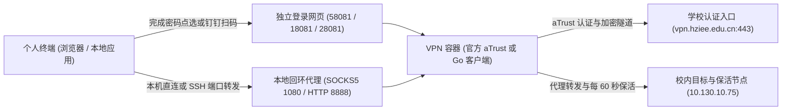

# HzieeVPN-easyconnect

面向杭州电子科技大学信息工程学院 VPN（学校入口：<https://vpn.hziee.edu.cn>，协议 `atrust`）的容器化部署方案与客户端源码仓库。容器在无桌面环境下建立校园网隧道，向本机提供标准 SOCKS5 与 HTTP 代理，并通过独立轻量网页完成密码验证码点选或钉钉扫码认证，无需安装远程桌面组件。



## 部署方案选型

本仓库由 [GitHub Actions](https://github.com/OyamaMeek/HzieeVPN-easyconnect/actions/workflows/build-image.yml) 自动构建并向 GitHub Container Registry（GHCR）发布两套镜像，对应以下三种部署方案：

| 部署方案 | Compose 配置文件 | 镜像标签与支持架构 | 登录认证方式 | 登录网页默认监听 | 宿主机代理端口 | 特点与适用场景 |
| --- | --- | --- | --- | --- | --- | --- |
| **方案一：官方 aTrust 客户端容器（推荐）** | [`deploy/hziee/compose.atrust.yaml`](deploy/hziee/compose.atrust.yaml) | `ghcr.io/oyamameek/hzieevpn-easyconnect:atrust-latest`（`linux/amd64`） | 统一网页支持**账号密码 + 点选验证码**与**钉钉扫码**双模式 | `0.0.0.0:58081`（登录成功或满 10 分钟自动关闭） | SOCKS5 `127.0.0.1:1080`<br>HTTP `127.0.0.1:8888` | 完整官方客户端协议兼容，无头 `Xvfb` 运行，内置每 60 秒保活；需宿主机提供 `/dev/net/tun` 与 `NET_ADMIN` |
| **方案二：Go 无图形客户端（账号密码）** | [`deploy/hziee/compose.headless.yaml`](deploy/hziee/compose.headless.yaml) | `ghcr.io/oyamameek/hzieevpn-easyconnect:latest`（`linux/amd64`、`linux/arm64`） | 学校上网账号密码（`auth/psw`、`ShenLan` 域）+ 验证码网页 | `127.0.0.1:18081`（仅首次登录期间由脚本启动） | SOCKS5 `127.0.0.1:1080`<br>HTTP `127.0.0.1:8888` | 用户态运行，无需 `tun` 设备与特权能力，支持 ARM64；需宿主机网络直连学校 VPN 数据节点 |
| **方案三：Go 无图形客户端（钉钉扫码）** | [`deploy/hziee/compose.dingtalk.yaml`](deploy/hziee/compose.dingtalk.yaml) | `ghcr.io/oyamameek/hzieevpn-easyconnect:latest`（`linux/amd64`、`linux/arm64`） | 钉钉扫码（`auth/dingtalk`、`dingtalk` 域） | `127.0.0.1:28081`（登录成功或满 10 分钟自动关闭） | SOCKS5 `127.0.0.1:11081`<br>HTTP `127.0.0.1:18889` | 无需在服务器保存账号密码，独立端口与会话目录，可与 `1080`/`8888` 服务同时部署 |

## 前置条件

1. **系统与硬件架构**
   - 方案一要求 `x86_64`（`linux/amd64`）Linux 主机，宿主机存在 `/dev/net/tun` 字符设备，且允许容器添加 `NET_ADMIN` 能力。
   - 方案二与方案三支持 `linux/amd64` 与 `linux/arm64`，运行在普通非 root 容器用户态环境。
2. **基础软件**
   - 已安装 Docker Engine 与 Docker Compose v2（支持 `docker compose` 子命令）。
   - 使用方案二的网页点选脚本 `deploy/hziee/captcha_web.py` 时，宿主机需安装 Python 3.9 或更新版本。
3. **网络连通性**
   - 部署主机需能正常连接学校认证入口 `https://vpn.hziee.edu.cn:443` 以及认证后分配的学校 VPN 数据节点（如 TCP `10441` 端口）。部分境外主机可能无法连接学校数据节点，建议部署在可直连学校节点的网络环境。
4. **端口与防火墙安全**
   - 代理端口默认仅绑定宿主机回环地址 `127.0.0.1`，避免在公网裸露未鉴权的代理服务。
   - 方案一与方案二均占用宿主机 `127.0.0.1:1080` 与 `127.0.0.1:8888`，同一台主机在同一时刻只运行其中一个服务。
   - 若通过公网高位端口（默认 TCP `58081`）访问方案一的登录网页，务必在云服务器安全组或宿主机防火墙仅向本人来源 IP 放行该端口；在公共网络环境优先采用 SSH 本地端口转发。

## 方案一：官方 aTrust 客户端容器部署（推荐）

该方案基于精简后的官方 Linux aTrust 客户端镜像构建，使用无监听端口的无头 `Xvfb` 承载客户端界面，在容器内直接提供“账号密码 + 钉钉扫码”二合一登录网页、`danted` SOCKS5 代理、`tinyproxy` HTTP 代理及每 60 秒保活脚本。

### 1. 准备部署目录与配置

确认宿主机 `/dev/net/tun` 可用，并创建用于持久化设备标识和登录态的数据目录：

```bash
ls -l /dev/net/tun
sudo mkdir -p /opt/hziee-vpn/data
sudo chmod 700 /opt/hziee-vpn/data
```

可通过以下任一方式准备 Compose 文件：

- **方式 A（克隆完整仓库）**：

  ```bash
  git clone https://github.com/OyamaMeek/HzieeVPN-easyconnect.git
  cd HzieeVPN-easyconnect/deploy/hziee
  ```

- **方式 B（仅部署单文件，无需克隆源码）**：

  将仓库中的 [`deploy/hziee/compose.atrust.yaml`](deploy/hziee/compose.atrust.yaml) 保存到服务器 `/opt/hziee-vpn/compose.yaml`（下文命令中的 `-f compose.atrust.yaml` 相应省略即可）。若需更换数据挂载路径，修改文件中 `volumes` 下的 `/opt/hziee-vpn/data:/root`。

### 2. 拉取镜像并启动容器

```bash
docker compose -f compose.atrust.yaml config --quiet
docker compose -f compose.atrust.yaml pull
docker compose -f compose.atrust.yaml up -d
docker compose -f compose.atrust.yaml logs --tail=50 -f atrust
```

当容器日志输出 `[aTrust Web] Ready on container loopback port 58081` 时，统一登录网页已准备就绪。按 `Ctrl+C` 可退出日志跟随，容器继续在后台运行。

### 3. 打开统一登录网页完成认证

根据服务器网络策略选择以下任一访问方式：

- **SSH 本地端口转发访问（推荐公网服务器采用）**：

  如无需公网直连，可将 `compose.atrust.yaml` 中的网页端口映射改为 `"127.0.0.1:${ATRUST_WEB_PORT:-58081}:${ATRUST_WEB_PORT:-58081}"` 并执行 `docker compose -f compose.atrust.yaml up -d` 生效。随后在个人电脑终端建立本地转发（`example.com` 为服务器地址占位符，请替换为实际主机地址与 SSH 用户名）：

  ```bash
  ssh -N -L 127.0.0.1:58081:127.0.0.1:58081 root@example.com
  ```

  保持 SSH 终端运行，在个人电脑浏览器打开 `http://127.0.0.1:58081/`。本地转发端口须与 `ATRUST_PUBLIC_PORTS`（默认 `58081`）一致，通过服务端 `Host` 与同源 `Origin` 校验。

- **公网高位端口直连访问**：

  在安全组限制仅允许本人 IP 访问 TCP `58081` 后，在浏览器打开 `http://203.0.113.10:58081/`（`203.0.113.10` 为服务器公网 IP 占位符）。在不可信网络中避免直接通过明文 HTTP 提交密码，优先使用 SSH 转发或前置 HTTPS 反向代理。

进入统一登录网页后，可任选一种认证模式：

1. **密码登录**：在“密码登录”标签页输入学校“上网账号(I-XG)”与密码（未包含 `@` 后缀时服务端默认补全 `@ShenLan` 登录域），点击“获取 / 刷新验证码”，按图片上方的提示文字依次点击对应字形，点击提交。每张验证码有效期为 5 分钟且仅可提交一次；若预登录会话超时，服务端会自动重载官方登录窗口并获取新验证码。
2. **钉钉扫码**：切换到“钉钉扫码”标签页，点击“刷新客户端二维码”，使用手机钉钉扫描页面二维码并在手机端确认登录。

**连接成功与自动关闭机制**：客户端完成认证进入在线状态（`online`/`login`）后，网页会直接显示本机 SOCKS5 开放端口（默认 `127.0.0.1:1080`，无账号密码、仅允许本地连接），随后登录网页服务自动关闭监听以收敛暴露窗口；容器启动满 10 分钟（`600` 秒）仍未完成登录时也会自动关闭网页。VPN 隧道、代理与每分钟保活继续后台运行。后续若会话过期需要重新登录，重启容器即可再次开启 10 分钟登录窗口：

```bash
docker compose -f compose.atrust.yaml restart atrust
```

### 4. 容器环境变量参考

可在 `compose.atrust.yaml` 的 `environment` 字段或宿主环境中按需覆盖以下参数：

| 环境变量 | 默认值 | 说明 |
| --- | --- | --- |
| `ATRUST_WEB_PORT` | `58081` | 容器策略路由放行及宿主机映射的登录网页端口（范围 `1024`–`65535`） |
| `ATRUST_LISTEN_PORT` | `58081` | 容器内登录网页实际监听端口，修改端口时须与 `ATRUST_WEB_PORT` 保持一致 |
| `ATRUST_PUBLIC_PORTS` | `58081` | 允许访问登录网页的 `Host` 端口白名单，支持英文逗号分隔多个端口（如 `58081,58443`） |
| `ATRUST_SOCKS_PORT` | `1080` | 宿主机仅绑定 `127.0.0.1` 的 SOCKS5 开放端口（无账号密码、仅允许本地连接，连接成功后在网页显示） |
| `PING_INTERVAL` | `60` | 容器内保活探测间隔秒数（非法值或 `0` 时自动回退为 `60`） |
| `PING_ADDR` | `10.130.10.75` | 每轮保活发送单次 ICMP ping 的目标地址；设为空字符串可关闭 ICMP 探测 |
| `PING_ADDR_URL` | `http://10.130.10.75/` | 每轮保活执行 HTTP GET 探测的目标 URL（超时 10 秒）；设为空字符串可关闭 HTTP 探测 |

## 方案二：Go 无图形客户端部署（账号密码登录）

该方案运行由本仓库 Go 源码编译的轻量客户端（源自 ZJU-Connect `v1.3.1`），默认预设学校入口 `vpn.hziee.edu.cn:443`、协议 `atrust`、认证方式 `auth/psw`、登录域 `ShenLan` 及校内保活地址 `http://10.130.10.75/`。

### 1. 填写账号配置文件

克隆仓库并进入部署目录，复制配置模板并收紧文件权限（已有 `headless.toml` 时 `-n` 参数会保留原文件）：

```bash
git clone https://github.com/OyamaMeek/HzieeVPN-easyconnect.git
cd HzieeVPN-easyconnect/deploy/hziee
cp -n headless.toml.example headless.toml
chmod 600 headless.toml
```

编辑 `headless.toml`，填写学校上网账号与密码：

```toml
username = "你的上网账号"
password = "你的密码"
```

### 2. 完成首次验证码交互登录

确认宿主机 `1080`、`8888`、`18081` 端口空闲，校验配置、拉取镜像并启动验证码辅助脚本：

```bash
docker compose -f compose.headless.yaml config --quiet
docker compose -f compose.headless.yaml pull
python3 captcha_web.py
```

`captcha_web.py` 会拉起一次性前台登录容器，并在 `127.0.0.1:18081` 启动带随机访问令牌的验证码页面，终端输出形如 `http://127.0.0.1:18081/#<token>` 的完整链接（复制链接时必须完整保留 `#` 及其后的令牌）：

- **远程服务器部署**：在个人电脑另开终端建立 SSH 本地转发（`example.com` 为服务器地址占位符），随后在本地浏览器打开服务器终端输出的完整链接：

  ```bash
  ssh -N -L 127.0.0.1:18081:127.0.0.1:18081 root@example.com
  ```

- **高位端口临时监听（可选）**：也可在安全组仅向本人 IP 放行高位端口后执行 `python3 captcha_web.py --host 0.0.0.0 --port 58081`。
- **纯命令行输入（可选）**：无需网页时可执行 `docker compose -f compose.headless.yaml run --rm --service-ports -it vpn`，按终端提示直接输入包含 `coordinates`、`width`、`height` 的 JSON 对象。

在验证码页面按提示依次点选对应文字并提交；若触发短信等二次认证，在运行脚本的服务器终端输入验证码。待日志显示认证通过且代理监听启动后，登录会话已写入 `deploy/hziee/headless-data/client_data.json`。按 `Ctrl+C` 终止前台登录进程。

### 3. 启动后台常驻服务

```bash
docker compose -f compose.headless.yaml up -d
docker compose -f compose.headless.yaml logs --tail=50 -f vpn
```

后台容器自动复用 `headless-data/` 中已保存的会话（日志显示 `Already logged in`），无需重复点选验证码；连接建立后立即请求一次 `http://10.130.10.75/`，此后每 60 秒自动执行一次 HTTP GET 保活探测（单次超时 10 秒）。

## 方案三：Go 无图形客户端部署（钉钉扫码登录）

该方案使用 [`deploy/hziee/dingtalk.toml`](deploy/hziee/dingtalk.toml)（预设 `auth_type = "auth/dingtalk"`、`login_domain = "dingtalk"`），无需配置账号密码，宿主机代理端口独立映射为 SOCKS5 `127.0.0.1:11081` 与 HTTP `127.0.0.1:18889`，会话保存在 `deploy/hziee/dingtalk-data/`。

1. **启动服务并查看扫码链接**：

   ```bash
   cd deploy/hziee
   docker compose -f compose.dingtalk.yaml config --quiet
   docker compose -f compose.dingtalk.yaml pull
   docker compose -f compose.dingtalk.yaml up -d
   docker compose -f compose.dingtalk.yaml logs --tail=30 -f vpn
   ```

2. **建立 SSH 转发并扫码**：

   扫码页仅绑定服务器 `127.0.0.1:28081`。在个人电脑建立 SSH 本地转发（`example.com` 为占位符）：

   ```bash
   ssh -N -L 127.0.0.1:28081:127.0.0.1:28081 root@example.com
   ```

   从容器日志复制 `DingTalk login page:` 后的完整链接（保留 `#` 后的随机令牌），在本地浏览器打开并用手机钉钉扫码确认。单次扫码窗口最长等待 10 分钟，认证完成后扫码网页自动关闭；若超时重启，需从最新日志重新复制新生成的链接。

## 连接验证与远程代理接入

### 1. 在服务器本机验证校内连通性

登录完成后，在服务器执行以下命令测试 HTTP 代理与 SOCKS5 代理访问校内地址（`--socks5-hostname` 表示由代理端完成校内域名解析）：

```bash
# 方案一或方案二（HTTP 8888 / SOCKS5 1080）
curl --noproxy '' --proxy http://127.0.0.1:8888 --max-time 15 -I http://10.130.10.75/
curl --noproxy '' --socks5-hostname 127.0.0.1:1080 --max-time 15 -I http://10.130.10.75/

# 方案三（HTTP 18889 / SOCKS5 11081）
curl --noproxy '' --proxy http://127.0.0.1:18889 --max-time 15 -I http://10.130.10.75/
curl --noproxy '' --socks5-hostname 127.0.0.1:11081 --max-time 15 -I http://10.130.10.75/
```

返回 HTTP 响应头（如 `HTTP/1.1 200 OK` 或 `302`）且 `curl` 退出码为 `0`，即代表 VPN 隧道与代理转发工作正常。

### 2. 在个人电脑通过 SSH 隧道使用代理

由于服务器代理默认仅绑定 `127.0.0.1`，远程办公或校外访问时，在个人电脑通过 SSH 本地端口转发安全接入（`example.com` 为服务器地址占位符）：

```bash
ssh -N -L 127.0.0.1:11080:127.0.0.1:1080 -L 127.0.0.1:18888:127.0.0.1:8888 root@example.com
```

随后在个人电脑的浏览器代理扩展（如 ZeroOmega / SwitchyOmega）、系统网络设置、终端或 IDE 中按需填写：

- **SOCKS5 代理**：`127.0.0.1`，端口 `11080`（勾选远程 DNS 解析以支持校内域名）
- **HTTP 代理**：`127.0.0.1`，端口 `18888`

## 日常运维与升级

在 `deploy/hziee` 目录下（将 `<compose文件>` 替换为实际使用的 `compose.atrust.yaml`、`compose.headless.yaml` 或 `compose.dingtalk.yaml`）：

```bash
# 查看运行状态
docker compose -f <compose文件> ps

# 查看实时日志（所有 Compose 均已配置单文件上限 10MB、最多保留 2 份的日志轮换）
docker compose -f <compose文件> logs --tail=50 -f

# 重启或停止服务
docker compose -f <compose文件> restart
docker compose -f <compose文件> stop
```

- **会话过期重新登录**：
  - **方案一**：执行 `docker compose -f compose.atrust.yaml restart atrust`，重新打开 `58081` 登录网页完成认证。
  - **方案二**：先执行 `docker compose -f compose.headless.yaml stop vpn`，运行 `python3 captcha_web.py` 完成点选并按 `Ctrl+C` 退出，再执行 `docker compose -f compose.headless.yaml up -d`。
  - **方案三**：执行 `docker compose -f compose.dingtalk.yaml restart vpn`，从日志获取新的 `#<token>` 链接扫码。
- **更新镜像与固定版本**：
  - 拉取最新构建镜像并平滑重建容器（挂载目录中的凭据与会话自动保留）：

    ```bash
    docker compose -f <compose文件> pull
    docker compose -f <compose文件> up -d
    ```

  - 如需在生产环境固定特定镜像版本，可将 Compose 文件中的 `:atrust-latest` 改为 `:atrust-sha-<完整提交哈希>`，或将 `:latest` 改为 `:sha-<完整提交哈希>`。

## 从源码构建与本地测试

向 `master` 分支推送代码或部署脚本变更后，[`.github/workflows/build-image.yml`](.github/workflows/build-image.yml) 会自动执行 Go、Python、Node.js 单元测试与 Compose 配置校验，随后构建并推送到 GHCR：

- **Go 客户端镜像**（[`Dockerfile`](Dockerfile)，`linux/amd64`、`linux/arm64`）：`ghcr.io/oyamameek/hzieevpn-easyconnect:latest` 与 `:sha-<完整提交哈希>`
- **官方 aTrust 统一登录镜像**（[`Dockerfile.atrust`](Dockerfile.atrust)，`linux/amd64`）：`ghcr.io/oyamameek/hzieevpn-easyconnect:atrust-latest` 与 `:atrust-sha-<完整提交哈希>`

在本地环境（需安装 Go 1.27.4、Python 3.9+、Node.js 及 Docker）可手工运行测试与构建：

```bash
# 运行全套单元测试与运行时脚本校验
go test ./...
python3 -B -m unittest discover -s deploy/hziee -p 'test_captcha_web.py' -v
node --test deploy/hziee/test_dingtalk_message.mjs deploy/hziee/test_atrust_qr.cjs deploy/hziee/test_atrust_runtime.cjs

# 本地编译 Go 客户端可执行文件与容器镜像
go build -trimpath -o bin/zju-connect .
docker build -t hziee-vpn:local .

# 本地构建官方 aTrust 统一登录镜像（linux/amd64）
docker build --platform linux/amd64 -f Dockerfile.atrust -t hziee-vpn:atrust-local .
```

## 常见问题排查

- **访问 `58081` 登录网页连接被拒绝或无响应**：登录网页在客户端上线或容器启动满 10 分钟后会自动关闭监听；如需重新登录，执行 `docker compose -f compose.atrust.yaml restart atrust`。公网直连时还需检查云服务器安全组与宿主机防火墙是否放行 TCP `58081`。
- **访问 `58081` 登录网页返回 `403 Forbidden`**：服务端校验请求头 `Host` 与同源 `Origin`。通过 SSH 本地端口转发或反向代理访问时，浏览器访问的端口须包含在容器环境变量 `ATRUST_PUBLIC_PORTS`（默认 `58081`）中。
- **方案一容器启动报错 `Failed to create tun interface`**：宿主机缺少 `/dev/net/tun` 设备或未授予 `NET_ADMIN` 能力；开启宿主机 TUN 模块，或改用无需 TUN 设备的方案二、方案三。
- **Go 客户端报错 `VPN client setup error: no reachable node for ip request`**：部署主机能够访问认证入口 `vpn.hziee.edu.cn:443`，但无法连接学校下发的 VPN 数据节点（如 TCP `10441` 超时）；请更换至能直连学校数据节点的网络环境。
- **启动容器提示端口被占用（`address already in use`）**：检查是否已有其他 VPN 容器或代理进程占用了 `1080`、`8888` 或 `58081` 端口，先停止冲突服务后再启动。

## 数据安全与开源许可

- `deploy/hziee/headless.toml`、`deploy/hziee/headless-data/`、`deploy/hziee/dingtalk-data/`、`deploy/hziee/data/` 已列入 [`.gitignore`](.gitignore)，服务器上的 `/opt/hziee-vpn/data/` 同样包含登录会话与设备凭据，请勿公开或提交至代码仓库。
- 已有容器手工接入脚本及 `systemd` 高位端口转发单元等补充说明见 [`deploy/hziee/README.md`](deploy/hziee/README.md)。
- Go 客户端源码源自 [ZJU-Connect](https://github.com/Mythologyli/ZJU-Connect)，遵循 [AGPL-3.0](LICENSE) 许可证，上游版本与定制说明见 [`SOURCE.md`](SOURCE.md)。原 `docker-easyconnect` 相关内容保留 [WTFPL](LICENSE.txt)。本项目为非官方项目。
